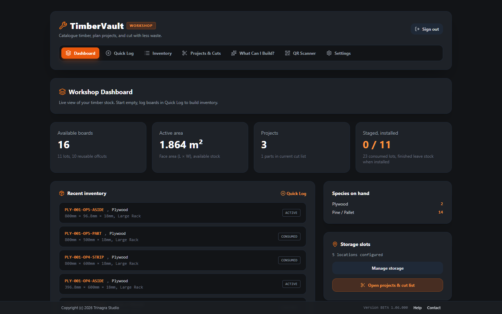
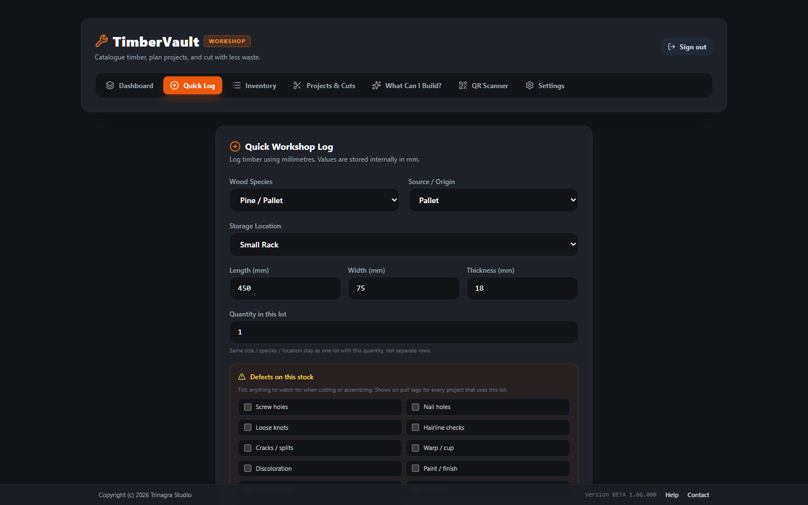
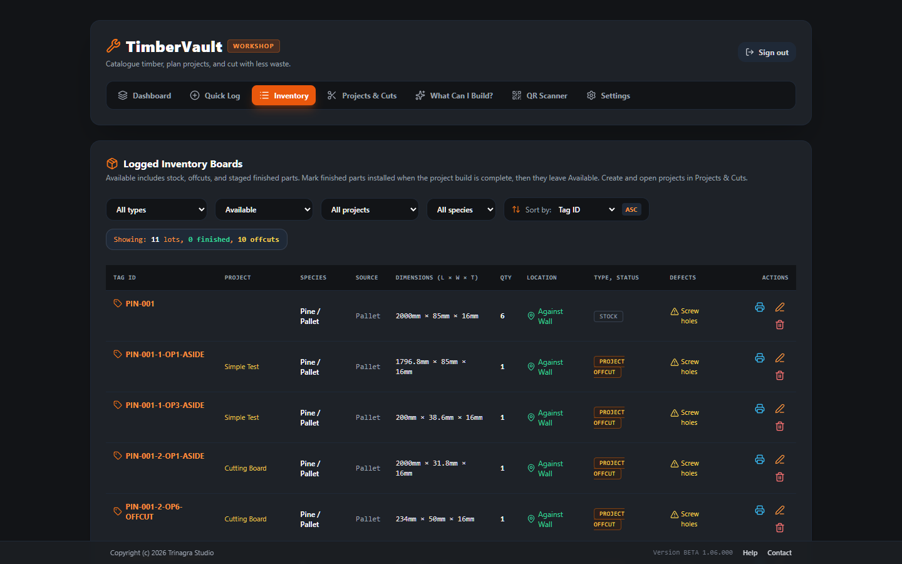
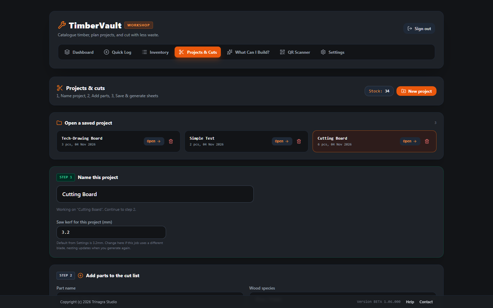
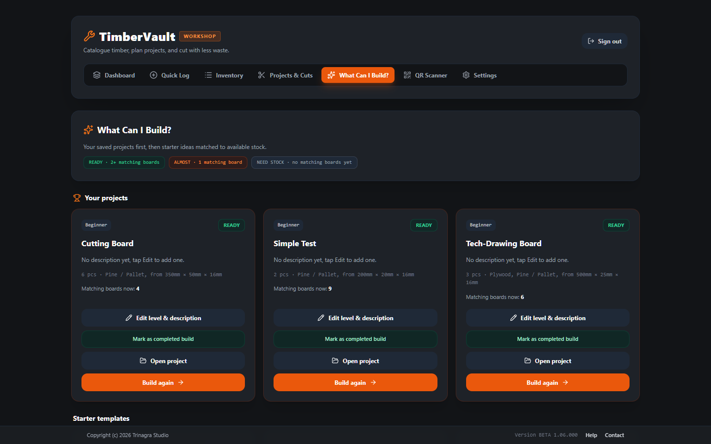
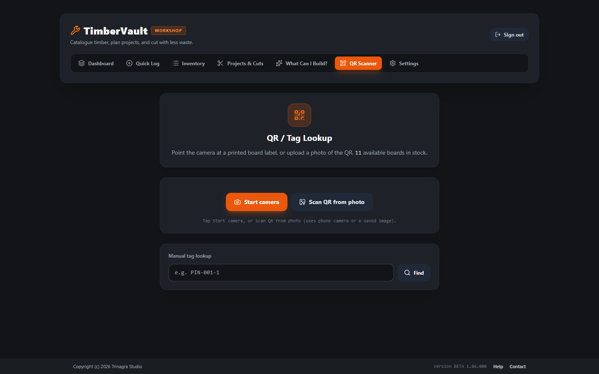
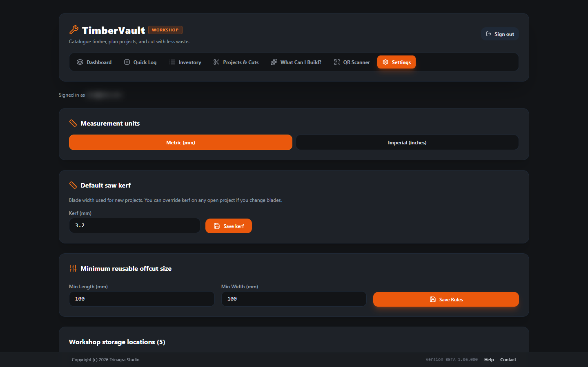
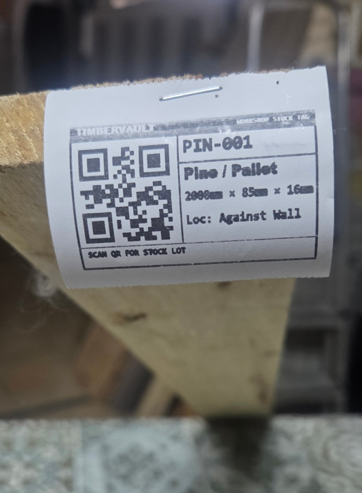

# TimberVault Help Guide

**Version:** BETA 1.06.000  
**Publisher:** Trinagra Studio

> **BETA notice:** TimberVault is a **BETA** product. Features, screens, and workflows are updated frequently. Expect changes between sessions; report issues via **Contact** in the app footer.

> **Browser app:** Works in your browser — nothing to download or install. Use it on your phone, tablet, or computer.

---

## What it is for

TimberVault is a workshop timber inventory and cutting planner. It helps you:

- Catalogue boards, offcuts, and finished pieces with locations and dimensions
- Plan projects and nest cut lists to reduce waste
- Match projects to stock you already have (“What Can I Build?”)
- Print QR stock tags (system print or save as image)
- Scan tags to find lots quickly
- Sync your workshop to the cloud when signed in

---

## Getting started

1. Open TimberVault in your browser.
2. **Log in** to load your own workshop data (demo preview may show sample stock when signed out).
3. Prefer **metric (mm)** or **imperial (inches)** under **Settings**.
4. Add storage locations that match your rack, shed, or shelves.
5. Log timber with **Quick Log**, then manage it in **Inventory**.

---

## What each tab does

### Dashboard
Your workshop home screen. Shows how much timber is available (piece count and face area), how many projects you have, and staged vs installed finished pieces. Lists recent lots, species currently on hand, and how many storage locations are configured. Use the shortcuts to jump into Quick Log, Settings, or Projects & Cuts.

### Quick Log
Fast way to add new timber to stock. Enter species, source, length / width / thickness, quantity, and storage location. Optionally mark defects (warp, knot, split, and so on) plus notes. TimberVault assigns a lot tag id automatically (based on species). After you save, the lot appears in Inventory and on the Dashboard.

### Inventory
Full catalogue of every lot: raw stock, reusable offcuts, waste remnants, and finished parts. Filter by status (available, staged, consumed), type (stock / offcuts / finished), species, or project. Sort columns, edit dimensions and location, delete lots, mark finished pieces installed, and open **Print label** for QR tags (system print or save as image).

### Projects & Cuts
Plan a build end to end. Name or open a project, add parts (name, species, size, quantity), set kerf and cutting strategy, then generate nested cutting sheets against available boards. Review shop drawings, save or pause projects when stock is short, resume later, and apply cuts so remnants / finished parts update Inventory.

### What Can I Build?
Idea finder for the timber you already have. Compares project templates and your saved projects to available boards by species and size. Shows READY / ALMOST / NEED STOCK so you can pick a realistic next build, then open it in Projects & Cuts to generate a cut list.

### QR Scanner
Find a board at the rack without typing. Start the camera (or upload a photo of a tag), scan the printed QR, and TimberVault looks up the lot. You can also type or paste a tag id. A match shows species, dimensions, location, defects, and status so you pull the right piece.

### Settings
Workshop preferences: metric (mm) or imperial (inches), default saw kerf for new projects, minimum size that counts as a reusable offcut, and your list of storage locations (rack, workbench, shed, and so on). Also shows who is signed in and tools to reset workshop data if you need a clean start.

*(Account email is blurred in the Settings screenshot.)*

---

## QR labels & printing

*Example: a printed Workshop Stock Tag on a board end — scan the QR in Inventory / QR Scanner to look up the lot.*

From a board in **Inventory**, open the label dialog:

- **System Print** — browser print dialog for a large readable label on A4/Letter.
- **Save PNG** — download the label as an image file.

Printed tags encode the board tag id so the **QR Scanner** can find the lot again.

---

## Cloud sync & accounts

- Signed-in sessions sync workshop data through Supabase-backed cloud sync.
- Signed-out browsing may show a **demo preview** only — log in for your real stock.
- Sign out from the header when finished on a shared machine.

---

## Tips

- Keep locations consistent (same names in Quick Log and Settings) so filters stay useful.
- Log reusable offcuts after a cut so the matcher and cut planner can reuse them.
- Print QR labels from Inventory so the QR Scanner can find lots at the rack.

---

## FAQ

**Is this finished software?**  
No. It is **BETA** and changes often as features are refined.

**Do I need an account?**  
Yes, to keep and sync your own workshop. Without login you may only see demo/sample data.

**Metric or imperial?**  
Either. Switch in **Settings**; dimensions convert for display while stock is stored consistently underneath.

**What does “consumed” mean?**  
The lot is no longer available as pullable stock (used up or installed finished work, depending on classification).

**Where do I get help or report a problem?**  
Use **Contact** in the footer (`silvervirtual@gmail.com`), or open **Help** in the footer for this guide inside the app.

---

## Contact

Trinagra Studio  
Email: [silvervirtual@gmail.com](mailto:silvervirtual@gmail.com)

Copyright (c) 2026 Trinagra Studio
